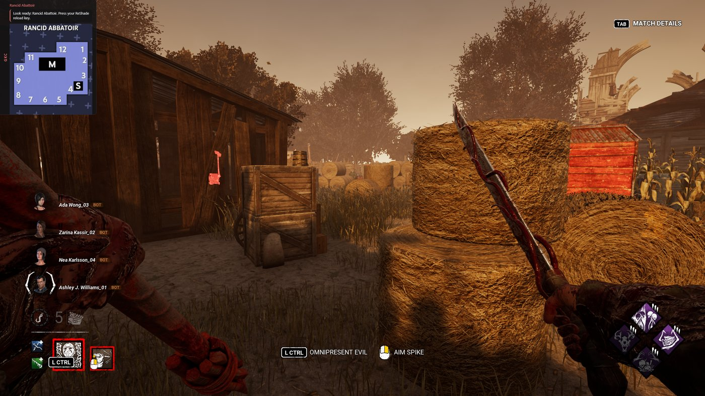
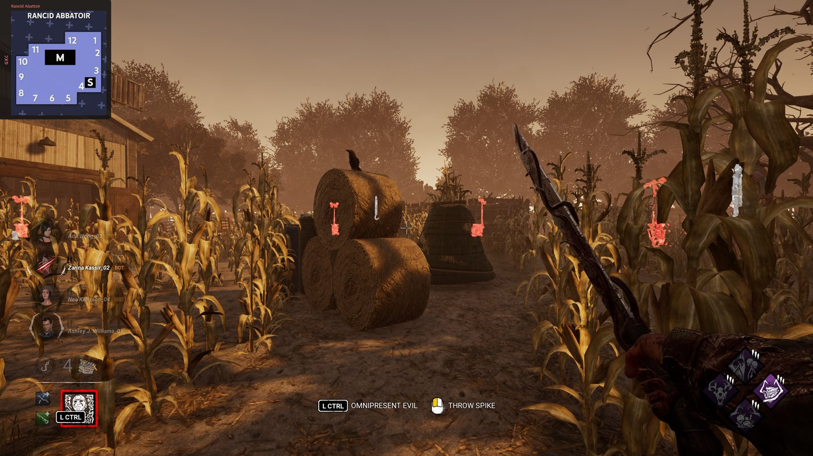
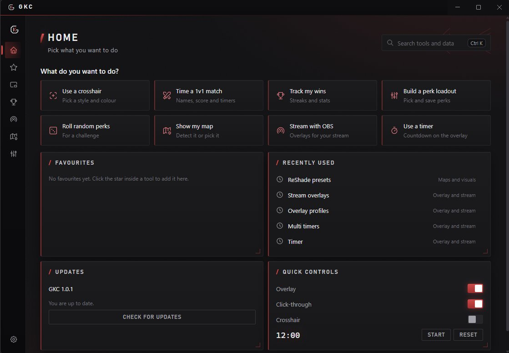

# GKC

A free toolkit for Dead by Daylight players on Windows: a map overlay with call-out layouts, ReShade presets that switch per map, a 1v1 timer, and a few more small tools in one app.

GKC is an independent fan project. It is not affiliated with, endorsed by or sponsored by Behaviour Interactive. GKC is currently free and non-commercial, and Dead by Daylight artwork belongs to Behaviour Interactive.

## Download

1. Go to the [latest release](https://github.com/gokill2432534343/gkc/releases/latest) and download `gkc-…-setup.exe`.
2. Run it. Windows may show **"Windows protected your PC"**, because the app is not code-signed yet (a signing certificate costs money). Click **More info**, then **Run anyway**. The full source code is in this repository.
3. Start GKC from the desktop shortcut. New versions are offered inside the app: a bar appears at the top, press **Download**, then **Restart and update**. Your settings are kept.

Windows 10 or 11 (64-bit) only.

## Screenshots

## What it does

- **Map overlay:** shows a call-out layout of the current map on top of the game. GKC can detect the map for you or you pick it by hand. Drag the overlay anywhere, change its size and transparency, and turn click-through on so clicks go to the game.
- **ReShade presets per map:** choose a ReShade look for every map, and GKC switches to it when the map changes. You press ReShade's own reload key once afterwards. GKC never presses keys for you.
- **1v1 timer:** names, score and timers for 1v1 matches, with different looks.
- **Streak tracker, crosshair, timers, unhook timer:** small tools for streaks and win rates, a custom crosshair, and countdowns on the overlay.
- **Perk and killer randomizers, build creator:** roll random perks or killers for a challenge, and save perk loadouts.
- **Stream overlays (OBS):** the overlays as browser sources for your stream. This is off until you turn it on, and it only listens on your own computer.
- **Backup:** save your whole setup to a file and load it on another PC.

## First steps

- Open **Settings, Overlay** (or set a hotkey for it) to show the overlay. Fullscreen games usually need **borderless windowed** mode for any overlay to be visible.
- GKC starts without hotkeys. Set the ones you want in **Settings, Hotkeys**. They work while the game is in focus.
- **Map detection:** press your detect hotkey (set it in **Settings, Hotkeys**) while the in-game menu shows the map name, or turn on auto mode. GKC reads the name from a screenshot of your main screen. The first start downloads English text data once.
- **ReShade:** open the **ReShade presets** tab and follow the setup steps there.

## What GKC does and does not do

- It does not read the game's memory, inject code, press keys or move your mouse. The map is read from a screenshot of your main screen, and hotkeys use the normal Windows shortcut system.
- Your settings are small files on your own PC (`%APPDATA%\gkc`). GKC keeps backups of them and a log file, both reachable from **Settings, Backup**.
- GKC only connects to the internet to look for updates on GitHub, to download the map text data once, and when you choose to send an idea or question (that opens a form in your browser).
- No ads and no accounts.

## Questions people ask

**Is it safe? Can I get banned?**
GKC does not touch the game: it does not read its memory, inject code, press keys or move your mouse. The map is read from a screenshot of your screen. Still, GKC is not approved by Behaviour Interactive, and nobody can promise how their anti-cheat treats any overlay or ReShade. Use it at your own risk and check Behaviour's current rules yourself.

**Why does Windows warn me about the installer?**
The app is not code-signed yet, because a signing certificate costs money. Click **More info**, then **Run anyway**. The full source code is in this repository.

**The overlay does not show over my game.**
Set Dead by Daylight to **borderless windowed** mode. A fullscreen game hides most overlays.

**Do I need ReShade?**
No. The map overlay and all other tools work without it. The ReShade tool only switches between preset files you already have.

**Does it cost anything?**
No. GKC is currently free, with no ads and no accounts.

## Ideas and questions

Missing something, or something unclear? Open **Settings, Ideas and questions** in GKC and write it down. Questions about how a function works are welcome too.

## Credits

- Map layout images by **Lethia**, shared by **Hens333** and used with his permission.
- Perk and killer names were compiled using the Dead by Daylight Wiki as a reference (names only).
- The map overlay idea is inspired by dbd-overlay by H4RDC0RN (Apache-2.0).
- Dead by Daylight and all related names and images belong to Behaviour Interactive.

## License

Copyright (c) 2026 gokill. GKC is licensed under the [PolyForm Noncommercial License 1.0.0](https://polyformproject.org/licenses/noncommercial/1.0.0), see the `LICENSE` file. You may use and change it for noncommercial purposes and share it with the notice kept, but not sell it or present it as your own. GKC is an unofficial fan project and is not affiliated with Behaviour Interactive.

The license covers GKC's own code only. It does not cover the map layout images (by Lethia), Dead by Daylight names, or any Behaviour Interactive artwork, which belong to their owners.

Third-party libraries and their licenses are listed in `THIRD-PARTY-LICENSES.md`.
